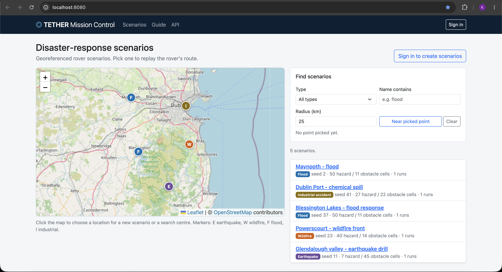
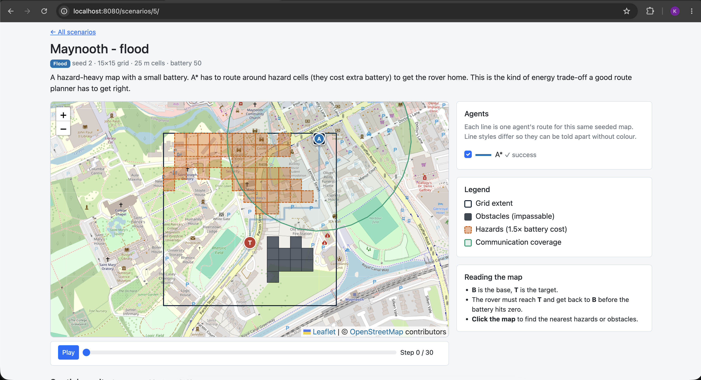
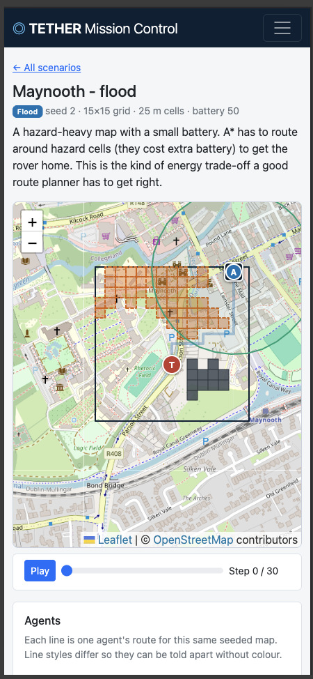

# TETHER Mission Control

A location-based services (LBS) web application for **simulated disaster-response rover missions**.
Each scenario is a grid placed on a real location. An A* rover
tries to find a target and return to base before its battery runs out, and every route is stored and analysed
as geometry in **PostgreSQL + PostGIS**.

Scenarios are generated from a seed, so the same seed always gives the same map.

- **Module:** Location-Based Services, Assignment 1
- **Stack:** PostgreSQL + PostGIS, Django, Leaflet, Bootstrap 5, Docker

## Features

- **Spatial database** with points, lines and polygons, GiST-indexed (including two geography indexes for metre-accurate queries).
- **Five PostGIS queries**: nearest hazards (KNN), hazard exposure (intersection), communication uptime (containment/`ST_DWithin`),
  point of no return (buffer) and scenarios near a point (radius search). See [docs/SPATIAL_QUERIES.md](docs/SPATIAL_QUERIES.md).
- **Django REST API** with GeoJSON output, CRUD, input validation, a consistent error format, token + session authentication,
  object-level permissions and throttling. See [docs/API.md](docs/API.md); the running app also serves interactive Swagger docs at `/api/docs/`.
- **Interactive Leaflet map**: map layers, the rover's route, a replay slider with play/pause, click-to-query popups, a proximity search.
- **Responsive, accessible UI** (Bootstrap 5): works from phone to desktop, keyboard operable, skip link, labelled controls,
  colour-independent line styles, live-region announcements.
- **Seeded, reproducible scenario generator** for four disaster types (earthquake, wildfire, flood, industrial accident).
- **Containerised deployment**: Django, PostGIS, pgAdmin 4 and Nginx on an isolated network with a custom subnet.

## Screenshots

| Scenario dashboard and proximity search | Mission map with replay and results table | Mobile layout |
|---|---|---|
|  |  |  |

## Quick start (Docker)

Requirements: Docker Desktop (or Docker Engine + the Compose plugin).

```bash
# In the project folder (the cloned repository, or the unzipped submission):
cp .env.example .env
# Edit .env: set DJANGO_SECRET_KEY, POSTGRES_PASSWORD, PGADMIN_DEFAULT_PASSWORD and DEMO_PASSWORD.
#   python3 -c "import secrets; print(secrets.token_urlsafe(50))"   # for the secret key

docker compose up --build
```

The `.env` file is git-ignored, so it is not in the repository: you create it from `.env.example` as above.

Once the containers are up (check with `docker compose ps`), open:

| Service | URL | Notes |
|---|---|---|
| Application | http://localhost:8080 | via the Nginx reverse proxy |
| pgAdmin 4 | http://localhost:5050 | log in with `PGADMIN_DEFAULT_EMAIL` / `PGADMIN_DEFAULT_PASSWORD`; the server "TETHER PostGIS" is pre-registered (it asks for the database password, `POSTGRES_PASSWORD`) |
| Django admin | http://localhost:8080/admin/ | needs a superuser (below) |

On first start the entrypoint applies migrations, creates the demo user and loads five demo scenarios with an A* run on each
(`SEED_DEMO=1`). Sign in with the demo user (`DEMO_USERNAME` / `DEMO_PASSWORD` from `.env`; see the test credentials below).

### Test credentials

These are the values I used when developing and demoing. Put them in `.env` (the demo user is only created
if `DEMO_PASSWORD` is set to something other than the placeholder):

| What | `.env` variables | Value |
|---|---|---|
| App sign-in (demo user) | `DEMO_USERNAME` / `DEMO_PASSWORD` | `*****` / `*****` |
| pgAdmin 4 login | `PGADMIN_DEFAULT_EMAIL` / `PGADMIN_DEFAULT_PASSWORD` | `*****` / `*****` |
| Database (also asked for when connecting in pgAdmin) | `POSTGRES_USER` / `POSTGRES_PASSWORD` | `*****` / `*****` |

These are throw-away local credentials for a local-only deployment, not real secrets.

`.env.example` already uses `*****` for `POSTGRES_USER` and `DEMO_USERNAME`. If you change `POSTGRES_USER`, also change `"Username"` in `pgadmin/servers.json`, which pre-registers the database in pgAdmin.

Useful commands:

```bash
docker compose exec web python manage.py createsuperuser   # optional admin account
docker compose exec web python manage.py test missions     # run the test suite
docker compose down            # stop (data is kept in the pgdata volume)
docker compose down -v         # stop and delete all data
```

Data persists across restarts in the named volumes `pgdata` and `pgadmin_data`.

### Run without Docker (development)

Requirements: Python 3.11+, PostgreSQL with PostGIS, and the GDAL/GEOS/PROJ libraries.

```bash
cd project
python -m venv .venv && source .venv/bin/activate
pip install -r requirements.txt
export DJANGO_DEBUG=1 POSTGRES_HOST=localhost POSTGRES_DB=tether POSTGRES_USER=<user> POSTGRES_PASSWORD=<password>
python manage.py migrate        # also creates the PostGIS indexes
python manage.py seed_demo
python manage.py createsuperuser
python manage.py runserver
```

(The PostGIS extension is enabled by the `postgis/postgis` image in Docker. When running without Docker, Django's PostGIS backend runs `CREATE EXTENSION IF NOT EXISTS postgis` during `migrate`, so the database user needs permission to create it, or run it once as a superuser.)

### Deploying beyond localhost

The brief asks for a local containerised deployment, which is what this is. The same `docker-compose.yml` runs on any Docker host
(for example a cloud VM), but I have only tested it locally. On a server you would also: set `DJANGO_ALLOWED_HOSTS` and
`DJANGO_CSRF_TRUSTED_ORIGINS` to the public address, use strong passwords, put TLS in front of Nginx and set `DJANGO_HTTPS=1`,
and swap Django's built-in server for an application server such as gunicorn.

## Using the application

A short guide is also built into the app at `/guide/`.

1. **Browse** the scenario list or map. Filter by type or name; click the map and use **Near picked point** to find scenarios within a radius.
2. **Open a scenario** to see its grid, base (B), target (T), obstacles, hazards and the radio coverage zone.
3. **Replay**: press Play or drag the slider to watch the rover move along its route.
4. **Click anywhere on the map** to list the three nearest hazards/obstacles with distances in metres.
5. Read the **results table**: success, battery left, path length, time inside hazards, radio coverage and point of no return.
6. **Sign in** to create scenarios (pick a type, location, seed and battery), edit a scenario's name and description, re-run the route, and delete your own scenarios.

## Technology stack

| Layer | Technology |
|---|---|
| Database | PostgreSQL 16 + PostGIS 3.4 (image `postgis/postgis:16-3.4`), managed with pgAdmin 4 or `psql` |
| Middle tier | Django 5 + GeoDjango, Django REST Framework, `djangorestframework-gis`, `drf-spectacular` (OpenAPI/Swagger docs), WhiteNoise |
| Front-end | Bootstrap 5.3, vanilla JavaScript (no build step), Leaflet 1.9 with OpenStreetMap tiles (both libraries are vendored in `project/static/vendor`) |
| Deployment | Docker Compose: `db`, `web`, `nginx`, `pgadmin` on network `tether_net` (172.28.0.0/24) |

## Project structure

```
tether-mission-control/
├── docker-compose.yml        # 4 services, custom subnet, health checks, named volumes
├── .env.example              # configuration template (no secrets)
├── nginx/default.conf        # reverse proxy + security headers
├── pgadmin/servers.json      # pre-registers the database in pgAdmin
├── docs/                     # architecture, API, spatial queries, diagrams, screenshots
└── project/                  # the Django project
    ├── Dockerfile, entrypoint.sh, requirements.txt
    ├── config/               # settings, root URLs, WSGI
    ├── missions/
    │   ├── models.py         # spatial schema (Model)
    │   ├── views.py, templates/, ../static/   # HTML pages (View/Controller)
    │   ├── api/              # REST controllers, serializers, error handling
    │   ├── spatial.py        # the five PostGIS queries
    │   ├── simulation/       # world generator, agents, persistence
    │   ├── migrations/       # schema + custom geography indexes
    │   ├── management/commands/  # seed_demo, bootstrap_demo
    │   └── tests/            # 39 automated tests
    └── static/               # css, js, vendored Bootstrap and Leaflet
```

## Architecture and design documents

- [docs/ARCHITECTURE.md](docs/ARCHITECTURE.md): component diagram, request flow, MVC mapping, security measures, database schema (ER diagram)
- [docs/diagrams/](docs/diagrams/): PNG copies of the architecture, database schema and request-flow diagrams
- [docs/SPATIAL_QUERIES.md](docs/SPATIAL_QUERIES.md): the five queries with SQL, purpose and `EXPLAIN` output
- [docs/API.md](docs/API.md): every endpoint with examples

## Security

- Secrets come from environment variables; the app refuses to start in production mode without a real `DJANGO_SECRET_KEY`.
- `DEBUG` is off by default; `ALLOWED_HOSTS` and CSRF trusted origins are configurable.
- The database port is not published to the host; only Nginx (and pgAdmin on localhost) are reachable.
- The web container runs as an unprivileged user.
- All SQL uses bound parameters; user input is validated by serializers; the API returns a uniform error envelope.
- Read access is public; writes need authentication; deleting needs ownership (or staff). API throttling is enabled.
- Nginx adds `X-Content-Type-Options`, `X-Frame-Options`, `Referrer-Policy` and `Permissions-Policy` headers.
- For HTTPS deployments set `DJANGO_HTTPS=1` to enable secure cookies and HSTS (TLS termination is not included in the local setup).

## Known issues and limitations

- Scenarios are simulations. The grid is a visual overlay on a real location; hazards are generated, not real data.
- Hazards and obstacles are static within an episode. Dynamic hazards (spreading fire, rising water) are a natural extension.
- The grid uses a local flat-earth approximation (accurate to well under one cell over a few hundred metres).
- Nearest-hazard distances use a spherical model (under half a percent from the spheroid; irrelevant at 25 m cells).
- Map tiles and the Swagger page (`/api/docs/`) need an internet connection; everything else works offline.
- Local deployment only: no TLS termination or automated backups are included, and Django runs on its built-in server (a production deployment would use an application server such as gunicorn).
- The built-in A* rover cannot make illegal moves, so the collisions metric is always 0 for it.
- Only one built-in agent (A*) is included; the agent field and API are designed so others could be added.

## Running the tests

To run the tests run this command: docker compose exec web python manage.py test missions

The suite covers the world generator (determinism and feasibility), the A* agent, the REST API
(authentication, permissions, validation, error format), every spatial query, the presence of the spatial indexes and the HTML pages.

## Acknowledgements

Map data &copy; [OpenStreetMap](https://www.openstreetmap.org/copyright) contributors. Built with
[Django](https://www.djangoproject.com/), [Django REST Framework](https://www.django-rest-framework.org/),
[djangorestframework-gis](https://github.com/openwisp/django-rest-framework-gis),
[drf-spectacular](https://drf-spectacular.readthedocs.io/), [PostGIS](https://postgis.net/),
[pgAdmin 4](https://www.pgadmin.org/), [Nginx](https://nginx.org/),
[WhiteNoise](https://whitenoise.readthedocs.io/), [Leaflet](https://leafletjs.com/) and
[Bootstrap](https://getbootstrap.com/). Leaflet and Bootstrap are vendored and redistributed under their MIT licences.

The Django/Docker project layout and the basic `db` + `web` compose structure follow the module's lab exercises (Weeks 1-5).
