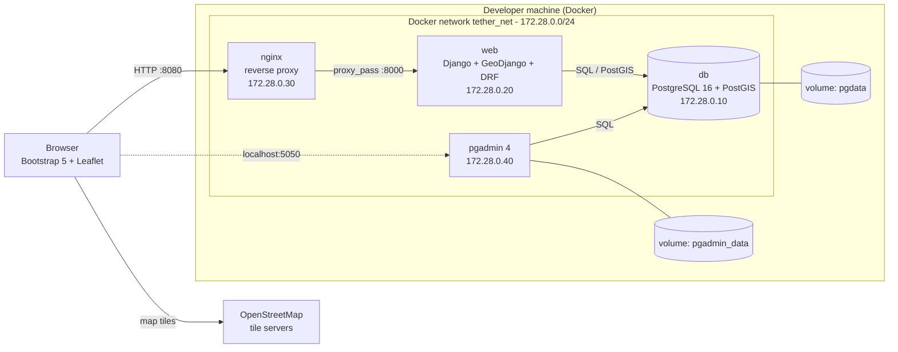
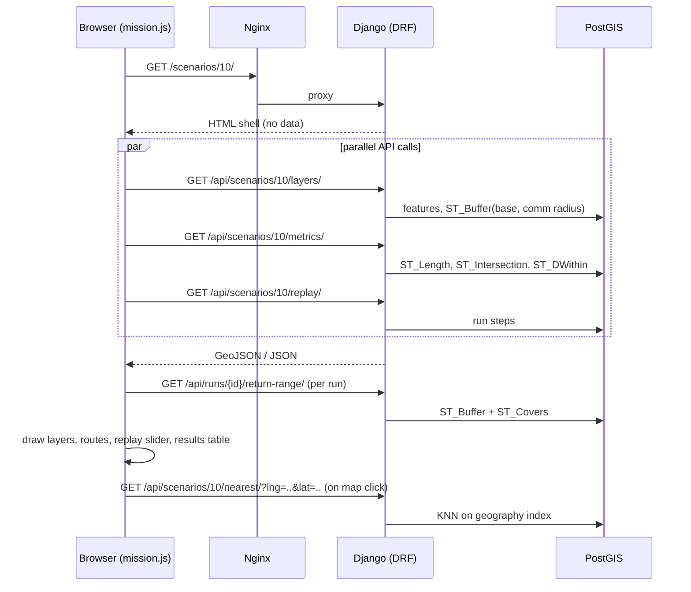
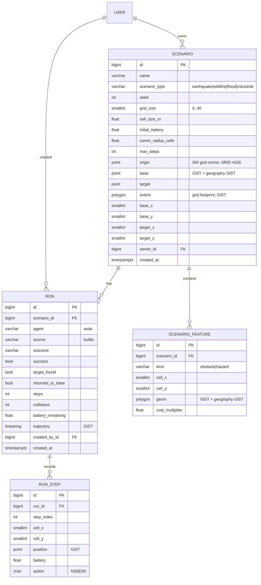

# Architecture

The diagrams below are Mermaid (rendered by GitHub). PNG copies for reports are in [`docs/diagrams/`](diagrams/): `architecture-components.png`, `sequence-replay.png`, `database-schema.png`.

## Components

Only Nginx (port 8080) and pgAdmin (bound to `127.0.0.1:5050`) are published to the host. The database is reachable
only from inside `tether_net`.

## MVC mapping

| MVC role | Where | Responsibility |
|---|---|---|
| **Model** | `missions/models.py`, `missions/spatial.py`, migrations | Spatial schema, constraints, indexes, PostGIS queries |
| **View** (presentation) | `templates/`, `missions/templates/`, `static/js`, `static/css`, serializers | HTML pages, Leaflet map, GeoJSON representation |
| **Controller** | `missions/views.py` (pages), `missions/api/views.py` (REST), `missions/urls.py`, `missions/api/urls.py` | Routing, authentication/permissions, request parsing, calling services |
| Simulation | `missions/simulation/` | World generation, agents, persistence (framework-independent where possible) |

`missions/simulation/world.py` and `agents.py` import nothing from Django, so they can be tested without a database.

## Request flow: replaying a scenario

The HTML pages are thin shells; all data comes from the REST API, so the API is the single source of truth and any other client
uses exactly the same endpoints as the browser.

## Database schema

Table names in PostgreSQL: `SCENARIO` is stored as `base_location` and `SCENARIO_FEATURE` as `rover_hazards` (set with `db_table` in `models.py`,
renamed in migration `0003_rename_tables`); `RUN` as `rover_route`; `RUN_STEP` keeps Django's default name `missions_runstep`.

Constraints worth noting: `scenario.grid_size` is limited to 5-40 and `cell_size_m > 0` (check constraints);
`(scenario, cell_x, cell_y)` is unique for features and `(run, step_index)` is unique for steps; deleting a scenario
cascades to its features, runs and steps; deleting a user sets owners to `NULL` rather than deleting data.
Indexes are listed in [SPATIAL_QUERIES.md](SPATIAL_QUERIES.md#indexes).

## Georeferencing

A scenario has a south-west `origin` and a `cell_size_m`. Cell `(x, y)` covers
`origin + (x, y) * cell_size_m` on a local flat-earth approximation
(`1 deg latitude = 111,320 m`, longitude scaled by `cos(latitude)`), where `x` runs east and `y` north. When a scenario is
created the origin is chosen so that the centre of the base cell lies exactly where the user clicked. The error of the
approximation over a few hundred metres is far below one cell. See `missions/simulation/geo.py`.

## Scenario generation and reproducibility

`generate_world(seed, type, size, battery)` seeds a private random-number generator from the arguments, grows obstacle and
hazard clusters according to a per-type profile, places the base in a corner region and the target in the far half, and
accepts the map only if the target is reachable and an optimal round trip costs at most 85 % of the battery. The same
arguments always give the same map; episodes are seeded separately so the A* run is reproducible too.

## Deployment configuration

| Concern | Mechanism |
|---|---|
| Configuration | environment variables (`.env`, template in `.env.example`) |
| Start-up order | `db` health check -> `web` (migrate, collectstatic, bootstrap) -> `nginx` waits for `web` health |
| Persistence | named volumes `pgdata`, `pgadmin_data` |
| Isolation | user-defined bridge network `tether_net`, subnet `172.28.0.0/24`, fixed addresses |
| Least exposure | DB port unpublished; pgAdmin on localhost only; container runs as non-root |
| Static files | collected at start-up and served by WhiteNoise |
